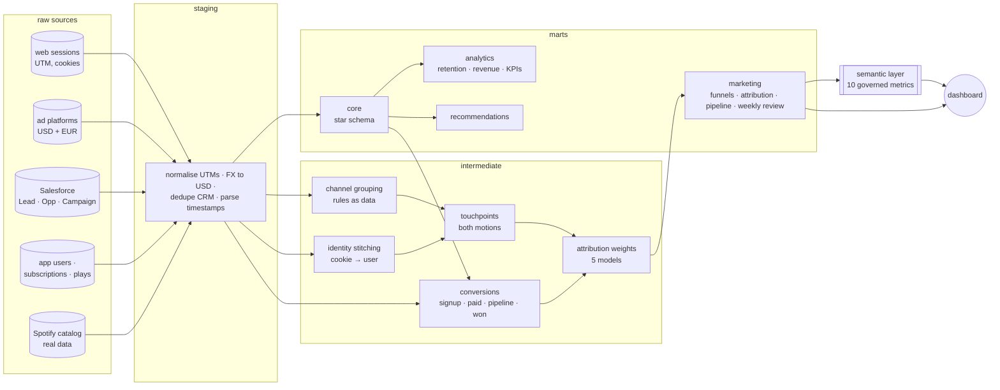

# 🎵 MUSE: Marketing Measurement & Product Analytics on dbt

[](https://github.com/larrozeemma-btz/muse-dbt/actions/workflows/dbt_ci.yml)

**MUSE** is a fictional music-streaming company with two go-to-market motions:
a **product-led** consumer app (freemium → premium) and a **sales-led** B2B offer,
*MUSE for Business* (background music for venues, gyms and retail chains).

This repository is MUSE's analytics layer, built end to end with dbt. It covers
**one measurement framework** that connects marketing activity to **pipeline,
revenue and product usage**, the data models behind it, the metric definitions
everyone agrees on, and the dashboard the weekly review reads.

| | |
|---|---|
| 📊 **Dashboard** | [Weekly marketing review](https://larrozeemma-btz.github.io/muse-dbt/), built from the marts |
| 📖 **Metric definitions** | [Metrics glossary](docs/metrics_glossary.md) + [semantic layer](models/marts/marketing/_semantic_layer.yml) |
| 💡 **Insights** | [Memo: where last-touch reporting misleads us](docs/insights_memo.md) |
| 🧪 **Quality** | 170 data tests, 3 unit tests, CI on every push, identical results on DuckDB and BigQuery |

---

## What the framework answers

| Question | Model |
|---|---|
| Which channels create demand, and which only capture it? | `fct_marketing_attribution`: 5 attribution models side by side |
| What does a signup / paid customer cost, per channel? | `rpt_attribution_by_channel`: credited conversions, spend, cost per conversion, ROAS |
| Where does the product funnel leak? | `rpt_plg_funnel`: visitor → signup → activated → paid, by first-touch channel |
| Which lead sources turn into revenue, and how fast? | `rpt_enterprise_funnel`: lead → MQL → SQL → opportunity → won, with velocity |
| What pipeline did marketing source vs influence? | `rpt_marketing_pipeline`: sourced (adds to 100 %) vs influenced (> 100 %) |
| How did we do this week? | `rpt_weekly_marketing_review`: spend, signups, CAC, leads, pipeline, bookings, WoW |
| How much of each outcome can we actually attribute? | `rpt_attribution_coverage` |

### Example finding

Content and paid search open **33 %** of signup journeys but receive **0 %** of
last-touch credit. Under last-touch, paid search costs **$4,040 per signup**.
Under position-based it costs **$115**. Full analysis and recommendations
in the [insights memo](docs/insights_memo.md).

---

## 🧭 Architecture



**Measurement design choices**
- **Channel grouping lives in a seed** ([`channel_grouping_rules.csv`](seeds/channel_grouping_rules.csv)), ordered first-match rules on `utm_source × utm_medium`.
  Marketing ops can change it without touching SQL. Unmapped traffic is reported and tested (warn above 2 %), never silently lumped into "other".
- **Identity stitching**: anonymous visits are credited to a user once a session carries both the cookie and the user id.
- **All five attribution models are computed**, in long format, so a sixth is one more `union`. Every model's credit sums to 100 % per conversion (tested).
- **Attribution is measured on signups**, and the paid upgrade is treated as a product metric. 47 % of upgrades have no marketing touch in the 30-day window, and the coverage report says so.
- **Funnels are strictly nested** (tested): only activated users count as the paid step, and users who pay without activating are reported separately.
- **Each motion's spend is divided by its own outcomes**: consumer spend by signups and paid conversions, enterprise spend by pipeline.
- **Sourced and influenced pipeline are reported side by side.** Judged on sourced pipeline alone, deal-acceleration programs (ABM, webinars) look worthless.
- **Spend is converted to USD at finance's planning rate** (`muse_eur_to_usd` var), and the reporting layer reconciles to the platforms' exports to the cent (tested).
- **Reports stop at the last complete week**, so a half-loaded week never reads as a collapse.

---

## 📊 The data

| Source | Real or simulated | Volume |
|---|---|---|
| Music catalog: [Spotify Tracks Dataset](https://huggingface.co/datasets/maharshipandya/spotify-tracks-dataset) (BSD) | **Real** | 89,740 tracks, 29,811 artists, 114 genres |
| App users, subscriptions, listening events | Simulated | 10k users, ~4M events, 11.7k subscriptions |
| Web sessions with UTMs, ad platform spend | Simulated | 282k sessions, 8.8k spend rows, $783k spend ($280k consumer, $503k enterprise) |
| Salesforce Leads, Opportunities, Campaign members | Simulated | 4k leads, 611 opportunities, 7.7k campaign responses |

Go-to-market data is never public, so [`scripts/load_marketing_data.py`](scripts/load_marketing_data.py)
simulates it with the patterns that make attribution hard in real life: content
and search open journeys, retargeting closes them, events and webinars source
enterprise pipeline, and partner referrals convert best. It also adds the usual
ingestion mess: UTM casing, `(none)` vs blank, sources nobody mapped yet, two
currencies, duplicate CRM rows.
[`scripts/load_raw_data.py`](scripts/load_raw_data.py) simulates listening
behaviour on top of the real catalog: sessions, skips, churn, a freemium funnel,
and late-arriving offline events.

---

## 🗂️ Model layers

| Layer | Highlights |
|---|---|
| `staging` | Salesforce, ad platforms, web analytics and app sources, renamed and typed: UTM normalisation, FX conversion, CRM dedup, two timestamp formats |
| `intermediate` | Channel grouping, identity stitching, touchpoints, conversions, attribution weights; sessionisation and the recommendation engine signals |
| `marts/marketing` | Attribution, funnels, pipeline, weekly review, campaigns and channels dimensions, semantic layer |
| `marts/core` | Star schema: users, tracks, artists, genres, many-to-many bridges, incremental event fact (on ingestion time, late-arrival safe) |
| `marts/analytics` | Daily KPIs, cohort retention, MRR by plan, play-context performance |
| `marts/recommendations` | Two-stage recommender (retrieval → scoring) producing a top-5 playlist per listener |

### Semantic layer

Ten governed metrics (`marketing_spend`, `consumer_marketing_spend`,
`enterprise_marketing_spend`, `signups`, `paid_conversions`, `pipeline_created`,
`closed_won_bookings`, `blended_cac`, `cost_per_signup`,
`pipeline_per_marketing_dollar`) are defined once in MetricFlow and validated
against the warehouse:

```bash
mf query --metrics marketing_spend,paid_conversions,blended_cac,pipeline_created --group-by metric_time__quarter
```

---

## ✅ Data quality

| Type | Examples |
|---|---|
| Generic | `unique`, `not_null`, `accepted_values`, `relationships` on every key; custom `score_between_0_and_100`, `unique_combination` |
| Business rules | Attribution credit sums to 100 % per model · funnels are monotonic · ad spend reconciles to the cent · no overlapping subscriptions · staging ↔ fact reconciliation |
| Governance (warn) | Unmapped traffic under 2 % · events on tracks removed from the catalog |
| Unit tests | Attribution weights on a 3-touch journey (first / last / U-shape) · 30-minute sessionisation · genre-family matching |

---

## 🚀 Run it

**Locally (DuckDB, free, ~1 minute)**

```bash
git clone https://github.com/larrozeemma-btz/muse-dbt.git && cd muse-dbt
python3 -m venv .venv && source .venv/bin/activate
pip install -r requirements.txt -r requirements-data.txt

python scripts/load_raw_data.py          # real catalog (20 MB download) + simulated listening
python scripts/load_marketing_data.py    # simulated go-to-market data
dbt build --profiles-dir .               # models + tests
python scripts/build_dashboard.py        # regenerates docs/index.html
```

**BigQuery / dbt Cloud.** `scripts/load_to_bigquery.py` loads the raw layer with free load jobs.
Production runs daily in dbt Cloud (`dbt build` + docs). Development runs land in
`dbt_dev_*` datasets so they never overwrite production
([`generate_schema_name`](macros/generate_schema_name.sql)). Dialect differences
are handled by adapter-dispatched macros in [`macros/cross_db.sql`](macros/cross_db.sql).
The same build gives identical marketing totals on both engines.

---

## 🛠️ Stack

`dbt-core 1.10` · `MetricFlow` · `DuckDB` · `BigQuery` · `dbt Cloud` · `Python` · `Chart.js` · `GitHub Actions`

## Why I built this, and how

I built MUSE to show how I approach marketing measurement. Start with the
questions leadership actually asks. Agree on the definitions before anyone
builds a chart. Then build the models and tests that make the numbers
trustworthy enough to make decisions with.

The measurement choices are mine, and they come from my marketing analytics
experience: which attribution models to compare, how strict an MQL should be,
why sourced and influenced pipeline belong side by side, and what the
dashboard should *not* let you sum. I built it with
[Claude Code](https://claude.com/claude-code) as a pair programmer, which let
me move fast on the engineering. The commits are co-authored to say so.

Emma Larroze
