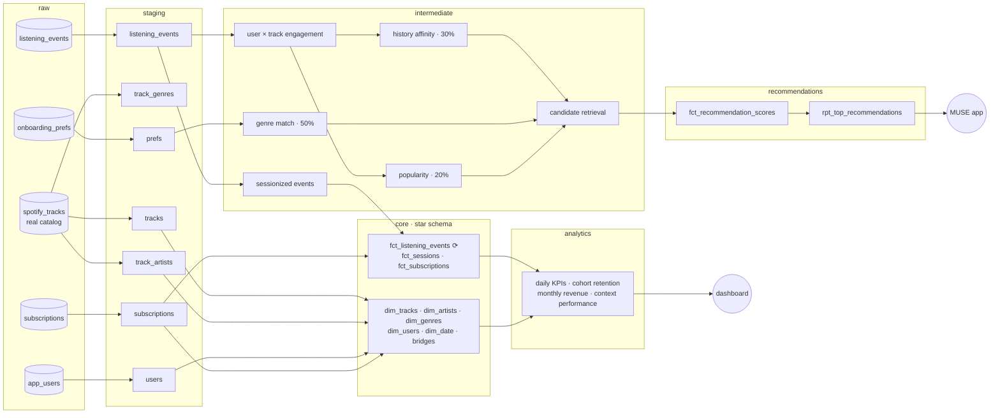

# 🎵 MUSE — Music Recommendation Data Warehouse

> *Your music. Your mood. Your algorithm.*

**MUSE** is a music-discovery concept that ranks songs for each listener with a
**transparent, explainable score**. This repository turns it into a
production-style **analytics engineering project** with dbt: a real music catalog
and millions of listening events go in; a tested star schema, product analytics
and a personalised **top-5 playlist per listener** come out.

```
score = 0.5 × genre match  +  0.3 × listening history  +  0.2 × popularity
```

Runs on **DuckDB** (local, free, zero setup) **and BigQuery** (dbt Cloud): every
dialect-specific bit of SQL goes through adapter-dispatched macros.

---

## 📊 The data

| Source | What | Volume |
|---|---|---|
| **Real** — [Spotify Tracks Dataset](https://huggingface.co/datasets/maharshipandya/spotify-tracks-dataset) (BSD) | Tracks, artists, albums, 114 genres, popularity, audio features (energy, valence, tempo…) | 114k rows → **89,740 tracks, 29,811 artists** |
| **Simulated** on top of the real catalog | Listeners, onboarding answers, subscriptions, listening events | 10k users → **~4M events**, 507k sessions, 12.7k subscriptions |

Listening behaviour is never published, so [`scripts/load_raw_data.py`](scripts/load_raw_data.py)
simulates it with realistic dynamics: user growth and churn, heavy-tailed activity,
commute & evening peaks, sessions, a popularity power law, heavy rotation, skips
that depend on taste fit, and a freemium funnel (free → premium, cancellations).

It also injects the **mess real pipelines receive**: duplicate deliveries,
two timestamp formats from two SDK versions, inconsistent casing, logged-out
events, events on tracks since removed from the catalog, and late-arriving
offline plays (`ingested_at` days after `event_at`). The catalog itself repeats
tracks once per genre and packs collaborators into `"Artist A;Artist B"` strings.

Scale it up with `--users 50000` (~20M events) on a roomier machine.

---

## 🧭 Architecture



| Layer | Highlights |
|---|---|
| **staging** | Dedup at-least-once events, parse 2 timestamp formats, explode `;`-separated artists into a bridge, one row per track from a one-row-per-genre source |
| **intermediate** | 30-minute-gap **sessionisation**, engagement points (play +1, repeat +2, like/playlist +3, skip −1), the three scoring signals, **two-stage recommender** (retrieval → scoring) |
| **core** | Star schema with **many-to-many bridges** (track↔artist, track↔genre), conformed `dim_date`, user lifecycle (active / at-risk / churned), **incremental** event fact on *ingestion* time with a 3-day lookback for late arrivals |
| **recommendations** | MUSE score for ~3M listener × candidate pairs, ranked; top-N playlist with a human-readable reason |
| **analytics** | DAU / streams / skip rate / MRR per day, signup-cohort retention triangle, MRR by plan, recommendation-surface performance vs playlists / search / radio |

### From pseudocode to SQL — a two-stage recommender

Scoring every listener × every track would be 10k × 90k = **900M pairs**. Like
production recommenders, MUSE first **retrieves** a few hundred plausible,
unheard tracks per listener (top tracks of their genres, more from artists they
love, global trending as the cold-start net), then **scores** only those:

```sql
{{ muse_score('genre_match_score', 'listening_history_score', 'popularity_score') }} as recommendation_score,
row_number() over (partition by user_id order by recommendation_score desc, popularity_score desc, track_id) as recommendation_rank
```

The deck's `O(n log n)` merge sort becomes the warehouse's sort inside a window
function, run for every listener at once.

```
u_000042  1  How Much Is The Fish?   Scooter                  45.9  because you listen to Scooter
u_000042  2  Paul Is Dead            Scooter;Timmy Trumpet    45.5  because you listen to Scooter
...
```

---

## ✅ Data quality — 109 tests

| Type | Examples |
|---|---|
| Generic | `unique`, `not_null`, `accepted_values`, `relationships` on every key |
| Custom generic | `score_between_0_and_100`, `unique_combination` (dependency-free) |
| Severity `warn` | Events on tracks removed from the catalog — monitored, not blocking |
| Singular | Weights sum to 1 · deck demo reproduced exactly · no already-heard track recommended · every listener gets a full playlist · staging ↔ fact reconciliation · no overlapping subscriptions |
| **Unit tests** | Slide 5 worked example (91.6) · 30-minute sessionisation rule · genre-family matching |

---

## 🚀 Run it locally (DuckDB)

```bash
git clone https://github.com/<your-username>/muse-dbt.git && cd muse-dbt
python3 -m venv .venv && source .venv/bin/activate
pip install -r requirements.txt -r requirements-data.txt

python scripts/load_raw_data.py        # downloads the catalog (20 MB) + simulates 10k listeners
dbt build --profiles-dir .             # ~30 s: 31 models, 106 data tests, 3 unit tests
dbt docs generate --profiles-dir . && dbt docs serve --profiles-dir .
```

Tune the algorithm without touching SQL:

```bash
dbt build --profiles-dir . --vars '{muse_weight_genre: 0.3, muse_weight_history: 0.5, muse_top_n: 10}'
```

## ☁️ Run it on BigQuery / dbt Cloud

```bash
pip install -r requirements-bigquery.txt
python scripts/load_to_bigquery.py --project <gcp-project> --credentials <service-account.json>
```

This loads the raw layer into a `raw` dataset (EU) with free load jobs. Then point
a dbt Cloud BigQuery connection (location **EU**) at this repo. On the **BigQuery
sandbox** (no billing, no DML) set the environment variable `DBT_BQ_SANDBOX=true`:
the incremental fact is then rebuilt as a partitioned, clustered table.

Cross-database macros live in [`macros/cross_db.sql`](macros/cross_db.sql)
(timestamp parsing, string explode, date spine, date arithmetic…).

---

## 🔭 Roadmap

- **Diversity re-ranking** — the sample above is all Scooter: cap tracks per artist in the top 5 (slide 10 "mix strong matches with new artists")
- **Learned weights** — fit 50/30/20 per listener from skips and likes
- **Context signal** — time of day / device as a fourth input
- **Offline evaluation** — hold out the last month of listening, measure precision@5
- **Snapshots** — `dbt snapshot` on onboarding preferences to track taste drift

---

`dbt-core 1.10` · `DuckDB` · `BigQuery` · `Python` · `GitHub Actions` — *Project by Emma Larroze.*
