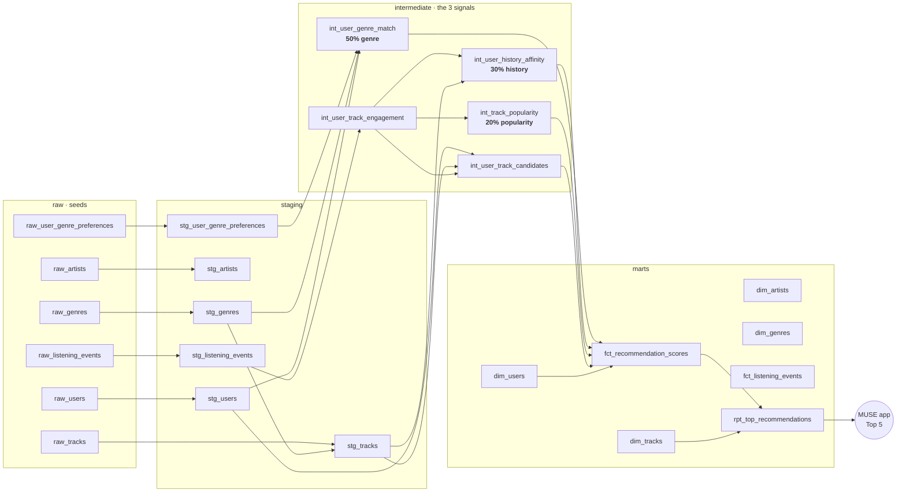

# 🎵 MUSE — Music Recommendation Data Warehouse (dbt + DuckDB)

> *Your music. Your mood. Your algorithm.*

**MUSE** is a music-discovery concept that ranks songs for each listener with a
**transparent, explainable score**. This repository turns the concept into a
production-style **analytics engineering project**: raw listening data goes in,
a tested dimensional model and a personalised **top-5 playlist per listener**
come out.

```
score = 0.5 × genre match  +  0.3 × listening history  +  0.2 × popularity
```

Runs fully locally on [DuckDB](https://duckdb.org) — no warehouse account needed.

---

## ✨ Highlights

| | |
|---|---|
| **Layered architecture** | `raw → staging → intermediate → marts`, one schema per layer |
| **Business logic as code** | The scoring formula is a reusable Jinja macro; weights, playlist size and event points are `vars` |
| **Explainability** | Every recommendation ships with its three input scores and a human-readable reason |
| **Cold-start handling** | Listeners with no history get the history weight redistributed instead of a silent 0 |
| **Discovery mode** | Tracks already played or liked are excluded from recommendations |
| **Incremental fact table** | `fct_listening_events` only processes new events on each run |
| **Data quality** | 68 data tests, custom generic tests, singular business-rule tests and dbt **unit tests** |
| **Reproducible data** | Deterministic Python generator with injected dirt (duplicates, casing, whitespace) |
| **CI** | GitHub Actions runs `dbt build` on every push / PR |

---

## 🧭 Lineage



---

## 🗂️ Data model

| Layer | Model | Grain | What it does |
|---|---|---|---|
| staging | `stg_muse__*` | 1:1 with raw | Dedup events, normalise casing, map messy genre labels to the taxonomy |
| intermediate | `int_user_genre_match` | user × genre | Declared genre = full affinity, same family (e.g. *Dream Pop* ↔ *Synth Pop*) = half |
| intermediate | `int_user_track_engagement` | user × track | Engagement points: play +1, repeat +2, like +3, skip −1 |
| intermediate | `int_user_history_affinity` | user × artist / genre | Engagement normalised 0–100 against the listener's own favourite |
| intermediate | `int_track_popularity` | track | Percentile of distinct listeners (0–100) |
| intermediate | `int_user_track_candidates` | user × track | Candidate pool (minus already-heard tracks) |
| core | `dim_users`, `dim_tracks`, `dim_artists`, `dim_genres` | entity | Conformed dimensions, incl. `is_cold_start`, skip rate, favourite genres |
| core | `fct_listening_events` | event | **Incremental** event fact with completion rate |
| recommendations | `fct_recommendation_scores` | user × track | The three signals, final MUSE score and per-user rank |
| recommendations | `rpt_top_recommendations` | user × rank | The top-N playlist with a `recommendation_reason` |
| presentation | `presentation_top5` | rank | Reproduces the pitch-deck demo (slide 8) |

### From pseudocode to SQL

The original algorithm:

```
FOR each song IN songList
    score ← 0.5 × genre + 0.3 × history + 0.2 × popularity
sortedSongs ← MERGE_SORT_DESCENDING(songList, score)
topFive ← FIRST MIN(5, LENGTH(sortedSongs)) songs
```

becomes, in `fct_recommendation_scores` / `rpt_top_recommendations`:

```sql
{{ muse_score('genre_match_score', 'listening_history_score', 'popularity_score') }} as recommendation_score,
row_number() over (partition by user_id order by recommendation_score desc, popularity_score desc, track_id) as recommendation_rank
...
where recommendation_rank <= {{ var('muse_top_n') }}
```

The `O(n log n)` merge sort is delegated to the warehouse's sort inside the window function, and it now runs for **every listener at once** instead of one list at a time.

---

## 🚀 Quickstart

```bash
git clone https://github.com/<your-username>/muse-dbt.git
cd muse-dbt
python3 -m venv .venv && source .venv/bin/activate
pip install -r requirements.txt

dbt build --profiles-dir .          # seeds + models + tests
dbt docs generate --profiles-dir . && dbt docs serve --profiles-dir .
```

See a listener's playlist:

```bash
dbt show --profiles-dir . --inline "select * from {{ ref('rpt_top_recommendations') }} where user_id = 'USR0021'"
```

Reproduce the deck's demo (Midnight Drive → 91.6):

```bash
dbt show --profiles-dir . -s presentation_top5
```

### Tune the algorithm without touching SQL

```bash
# Favour listening history over genre, return a top 10
dbt build --profiles-dir . --vars '{muse_weight_genre: 0.3, muse_weight_history: 0.5, muse_top_n: 10}'
```

A singular test (`assert_scoring_weights_sum_to_one`) fails the build if the weights don't sum to 1.

---

## ✅ Testing strategy

| Type | Examples |
|---|---|
| Generic (built-in) | `unique`, `not_null`, `accepted_values`, `relationships` on every key |
| Generic (custom) | `score_between_0_and_100`, `unique_combination` (no package dependency) |
| Singular | Weights sum to 1 · deck output reproduced exactly · no already-heard track recommended · every listener gets a full playlist |
| Unit tests | Slide 5 worked example (`96×0.5 + 92×0.3 + 80×0.2 = 91.6`) · genre-family matching logic |

---

## 🧪 Data

All data is **synthetic and fictional**, generated by [`scripts/generate_seed_data.py`](scripts/generate_seed_data.py)
(fixed random seed): 60 listeners (10 % cold-start), 25 artists, 120 tracks, 15 genres, ~3.3k listening events.
To mimic real ingestion, it injects duplicate events, mixed-case event types / plans and whitespace in genre labels.

```bash
python3 scripts/generate_seed_data.py   # regenerates seeds/*.csv
```

---

## 🔭 Roadmap (from the MUSE deck)

- **Learn preferences** — fit weights per listener from skips, likes and repeats instead of fixed 50/30/20
- **Add context** — time of day, activity or mood (with consent) as a fourth signal
- **Improve discovery** — reserve playlist slots for new artists (diversity re-ranking)
- **Snapshots** — track how a listener's taste evolves over time (`dbt snapshot` on genre preferences)

---

## 🛠️ Stack

`dbt-core 1.10` · `dbt-duckdb` · `DuckDB` · `Python 3` · `GitHub Actions`

*Project by Emma Larroze.*
